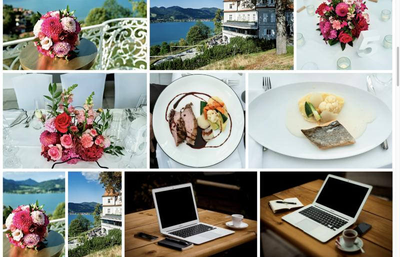
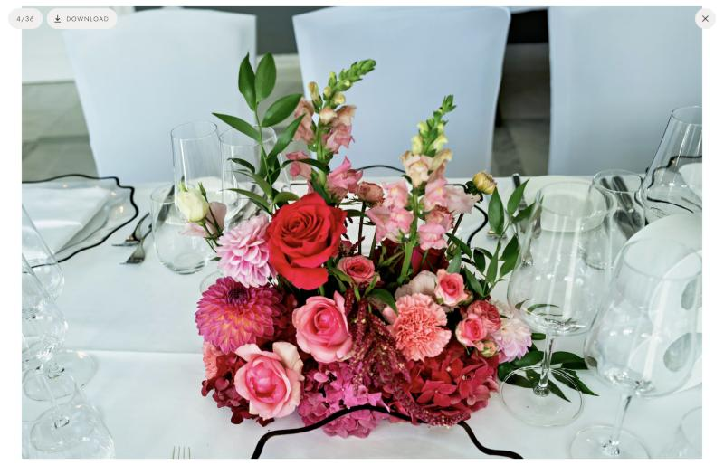

# Event Reportage Photo Gallery

A password-protected gallery for photo reportages of events and weddings. Static front end built with Astro, a tiny PHP gate on any shared web host, a full-screen viewer with touch gestures, and privacy-friendly statistics with a weekly mail.


## Why another gallery

- **Guests, not accounts.** One shared password (printed on the invitation or in a QR code with `?pw=...`), remembered for a year. No sign-up, no app.
- **Fast on phones.** Three image sizes per photo (600, 1200 and 2500 px), a justified grid that loads only what is on screen, and a viewer that shows the preview while the large file decodes.
- **Feels native.** Swipe between photos with the neighbour following your finger, pinch to zoom, swipe down to close, tap zones for back and forward, keyboard navigation on the desktop.
- **Brute force is throttled.** Ten wrong passwords from one address block it for ten minutes, and every wrong attempt costs half a second. No database, just a tiny file per address hash.
- **Photos stay private.** The built page and the photos live behind the gate. Direct links to the files are blocked by `.htaccess`, and the browser gets proper file names when guests save a photo.
- **Runs anywhere PHP runs.** No database, no framework on the server. Four small PHP files plus the static build. Deploys over SFTP from GitHub Actions on every push.
- **Statistics without tracking.** A local log with daily rotating visitor hashes, no IP addresses, no cookies beyond the password. A designed weekly report mail with the photo of the week and the most downloaded photo.

| Grid | Viewer | Phone |
|---|---|---|
|  |  |  |

## Live demo

A static demo without the password gate runs on GitHub Pages: https://tbx.github.io/event-reportage-photo-gallery/ (the `pages` workflow publishes it on every push; the real thing on a PHP host adds the gate, the statistics and the weekly mail).

## Quick start

You need Node 22 or newer. The repo ships demo photos so the first build works without any setup.

```bash
npm install
npm run photos     # renders demo-photos/ into public/protected/photos/ (small, thumb, full)
npm run build      # Astro build + checks, result in dist/
npm run serve      # local test server without PHP: http://localhost:8080/gallery/  (password: demo)
```

The test server emulates the PHP gate, the image endpoint and the `.htaccess` rules, so you can try the gallery before you have a web host.

## Make it yours

1. **Edit `gallery.config.json`.** Names, date, subtitle, photographer, cover photo, base path (`/gallery`), site URL, download prefix and every text that guests see. The PHP side reads the same file (copied to `dist/_config.json` at build time), so there is one place to change things.
2. **Set the secrets in `public/_auth.php`.** The guest password, a random secret that signs the cookie, the statistics password, the key for the weekly report and the mail addresses. The build warns while the placeholders are still in place.
3. **Point `PHOTOS_SRC` at your photos.** Copy `.env.example` to `.env` and set the folder with your full-resolution JPEGs. File names must start with a number (`001 - something.jpg`), which defines the order. `npm run photos` renders every size, strips all metadata except the sRGB profile, and writes `src/data/photos.json`.
4. **Pick the cover.** `coverFile` in the config is the start of a file name, e.g. `"007 - "`. An optional `coverFilePortrait` picks a different photo for phones held upright.
5. **Remove the demo photos** (`demo-photos/`) once you have your own.

### Updating photos later

`npm run photos` is incremental. It reuses results that did not change, renumbers photos when something was inserted or removed, and copies everything that changed into `public/protected/photos-changed/` so you can upload only that. Use `npm run photos -- --all` to recompute everything.

## Deploy

The gallery runs on any host with Apache and PHP 8 (`.htaccess` with `mod_rewrite`). The code goes up with GitHub Actions, the photos go up once from your machine.

1. Create a repository from this project and push it.
2. Add the repository secrets `SFTP_HOST`, `SFTP_USER`, `SFTP_PASSWORD` and the variables `SFTP_PORT` (optional, default 22) and `SFTP_REMOTE_DIR` (optional, default is the base path without the slash, e.g. `gallery`).
3. In `.github/workflows/deploy.yml` uncomment the `push` trigger. From then on every push to `main` builds and uploads the code: `.htaccess`, `index.php`, `img.php`, `hit.php`, `stats.php`, `_auth.php`, `_config.json`, `galerie.html`, fonts and assets.
4. Upload the photos once from your machine. Put the same SFTP values into `.env` and run:

```bash
npm run deploy:photos
```

The upload skips files that are already on the server with the same size, so it can be resumed.

The result lives at `https://your-domain/gallery/` (or whatever base path you configured). The QR variant `https://your-domain/gallery/?pw=PASSWORD` logs guests in directly and drops the password from the URL.

## Statistics and the weekly mail

`stats.php` shows visitors, opens, photo views and downloads per day plus the most viewed and most downloaded photos. It has its own password (`STATS_PASSWORD`).

The weekly mail is triggered by the `weekly-report` workflow every Monday once you uncomment its `schedule` block. Set the repository variable `STATS_URL` (e.g. `https://your-domain/gallery/stats.php`) and the secret `STATS_KEY` (same value as in `_auth.php`). The mail is HTML with the photos embedded, and `stats.php?preview=1` shows it in the browser when you are logged in.

What is logged: a timestamp, the event (open, view, download), the photo number and a hash of IP address, user agent and the day. The hash changes every day and cannot be reversed. No IP addresses are stored. `stats.php?prune=YYYY-MM-DD&key=STATS_KEY` removes everything before a date (with a backup copy).

## Originals package

`npm run originals` builds a folder of full-resolution files named like the gallery downloads, with GPS data removed and the photographer written into the copyright fields, ready to zip for the couple. It needs `PHOTOS_SRC` and uses `exiftool-vendored`.

## Project layout

```
gallery.config.json       names, texts, paths (one file for Astro and PHP)
src/pages/galerie.astro   page markup and CSS
src/scripts/galerie.js    grid, cover, viewer, gestures
public/                   PHP gate, image endpoint, statistics, .htaccess, fonts
public/protected/photos   rendered photos (generated, not in the repo)
scripts/photos.mjs        image pipeline (sharp)
scripts/deploy.mjs        SFTP upload
scripts/test-server.mjs   local server that emulates the PHP side
scripts/originals.mjs     originals package
scripts/pages.mjs         static demo for GitHub Pages
demo-photos/              sample photos, see CREDITS.md there
.github/workflows/        deploy on push, weekly report, Pages demo
```

## Texts and language

All texts that guests see are in `gallery.config.json` under `texts` and in `lang`, so the gallery can run in any language. The subtitle may contain `{photographer}`, which becomes a link to `photographerUrl`. The statistics page and the report mail are English only.

## Credits

- Demo photos by [@tbx](https://x.com/tbx), for trying the gallery out only. See `demo-photos/CREDITS.md`.
- Fonts [Jost](https://github.com/indestructible-type/Jost) and [Great Vibes](https://fonts.google.com/specimen/Great+Vibes), both under the SIL Open Font License (see `public/fonts/`).
- Built with [Astro](https://astro.build) and [sharp](https://sharp.pixelplumbing.com).

## License

MIT, see `LICENSE`.
